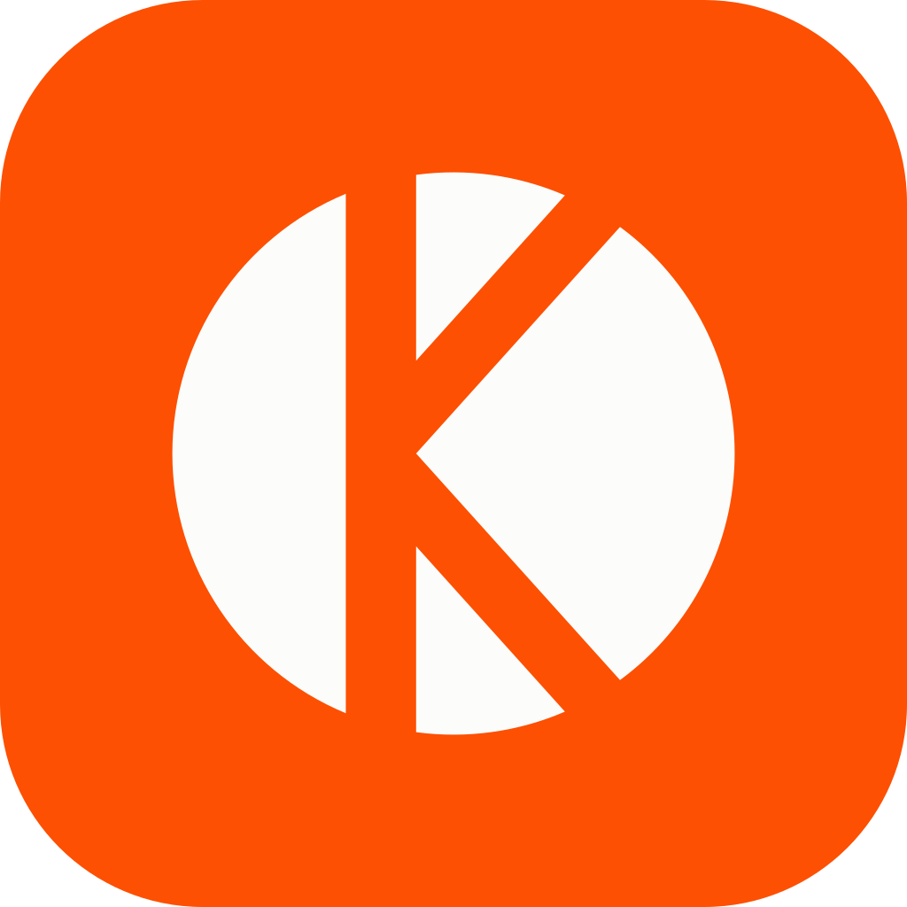

<div align="center">

<a href="https://kalamio.com">
  
</a>

<h1>Kalamio</h1>

<p><strong>The open-source publishing platform for every voice.</strong><br>
Write long-form stories and quick thoughts, build a publication, and reach readers who care.</p>

<p>
  <a href="https://kalamio.com"><strong>kalamio.com</strong></a>
  ·
  <a href="CONTRIBUTING.md">Contributing</a>
  ·
  <a href="https://github.com/kalamiohq/kalamio/issues/new?template=bug_report.yml">Report a bug</a>
  ·
  <a href="https://github.com/kalamiohq/kalamio/issues/new?template=feature_request.yml">Request a feature</a>
</p>

<p>
  <a href="https://github.com/kalamiohq/kalamio/actions/workflows/ci.yml"></a>
  <a href="LICENSE"></a>
  <a href="CONTRIBUTING.md"></a>
</p>

</div>

<picture>
  <source media="(prefers-color-scheme: dark)" srcset=".github/assets/home-dark.webp">
  
</picture>

## About

Kalamio is a modern home for writing on the web. Writers get a distraction-free editor, a feed that
puts their work in front of the right readers, and the tools to grow an audience: publications,
followers, comments and analytics. Readers get a clean, fast reading experience in light or dark.

Kalamio is in **public beta** at [kalamio.com](https://kalamio.com). The entire platform is open
source under the [AGPL-3.0](LICENSE), and contributions are welcome.

## Features

### Writing

- **Rich editor:** headings, lists, quotes, tables, syntax-highlighted code blocks, images with
  captions and file attachments
- **Embeds:** YouTube, Spotify, Loom, CodePen, Figma, GitHub Gists, X (Twitter), Instagram and TikTok
- **Drafts that don't get lost:** autosave, a drafts dashboard, and a preview before you publish
- **Short posts and polls:** share a quick thought, a few images or a poll without writing a full article
- **Publications:** bring articles together under a shared name that readers can subscribe to

### Reading

- **A feed that fits you:** For You, Following, Trending, and topic tabs from AI to Fitness
- **Reads:** a full-screen feed with one story per screen
- **Bookmarks and collections:** save articles and organise them into collections
- **Pick up where you left off:** articles you've started stay in your sidebar
- **Search** across articles and writers, in **light and dark** themes

### Community

- Likes, threaded comments (with images and polls) and @mentions
- Follows and publication subscriptions
- Real-time notifications and direct messages, with message requests from people you don't follow
- Privacy controls, blocking, and per-type notification settings

### For writers

- **Analytics:** an overview of your reads, your top posts and follower growth
- **Built to be found:** rich link previews when articles are shared, and an automatic sitemap

<table>
  <tr>
    <td width="50%">
      <picture>
        <source media="(prefers-color-scheme: dark)" srcset=".github/assets/editor-dark.webp">
        
      </picture>
    </td>
    <td width="50%">
      <picture>
        <source media="(prefers-color-scheme: dark)" srcset=".github/assets/reading-dark.webp">
        
      </picture>
    </td>
  </tr>
  <tr>
    <td align="center">The editor</td>
    <td align="center">The reading view</td>
  </tr>
</table>

## Tech stack

| Layer | Built with |
|---|---|
| **Frontend** | React 18, Vite, Tailwind CSS, TipTap (ProseMirror), TanStack Query, Socket.IO client |
| **Backend** | Node.js, Express, MongoDB with Mongoose, Socket.IO, Zod, Passport (Google sign-in) |
| **Infrastructure** | Google Cloud Run and Cloud Build, Cloudflare, MongoDB Atlas, AWS S3 with a CDN, Upstash Redis, Resend |

## Getting started

Run the whole platform on your machine in about five minutes. You don't need any cloud accounts:
Docker provides the database, file storage, Redis and an email inbox locally.

**Prerequisites:** [Node.js 22](https://nodejs.org/) and [Docker](https://docs.docker.com/get-docker/)

```bash
git clone https://github.com/kalamiohq/kalamio.git
cd kalamio

docker compose up -d                    # MongoDB, Redis, file storage, email inbox

cp server/.env.example server/.env      # ready to use with the local services
cp frontend/.env.example frontend/.env

cd server && npm install && npm run seed && cd ..   # demo writers, articles and comments
cd frontend && npm install && cd ..
```

Then start the API and the app in two terminals:

```bash
cd server && npm run dev                # http://localhost:8080
cd frontend && npm run dev              # http://localhost:5173
```

Open **http://localhost:5173** and sign in as `demo@example.com` with the password `Demo1234`.
Emails sent by the app, like sign-up codes, appear at **http://localhost:8025**.

See [CONTRIBUTING.md](CONTRIBUTING.md) for the full guide, project structure, tests and troubleshooting.

## Project structure

```
frontend/            React app (Vite): pages, components, editor extensions, data hooks
server/              REST API and real-time server (Express, Mongoose, Socket.IO)
  controllers/       request handlers        Schema/        database models
  routes/            URL → handler mapping   services/      email, tokens, sign-in codes
  middleware/        auth, caching, limits   scripts/       seed data and maintenance scripts
docker-compose.yml   local development services
docs/                self-hosting guide
```

## Self-hosting

Kalamio ships as two Docker images, the API ([`server/Dockerfile`](server/Dockerfile)) and the web
app ([`frontend/Dockerfile`](frontend/Dockerfile)). They run on any container host with MongoDB,
S3-compatible storage and an SMTP provider.

[docs/self-hosting.md](docs/self-hosting.md) covers configuration, storage, scaling and running behind a CDN.

## Contributing

We'd love your help, whether it's a bug fix, a new feature, documentation or design feedback.

1. Read the [contributing guide](CONTRIBUTING.md) and our [code of conduct](CODE_OF_CONDUCT.md).
2. Pick an issue: [`good first issue`](https://github.com/kalamiohq/kalamio/labels/good%20first%20issue)
   is a great place to start.
3. Open a pull request. On your first one, you'll be asked to sign our [CLA](CLA.md) with a one-line comment.

## Security

Please report security vulnerabilities privately, never in public issues.
See [SECURITY.md](SECURITY.md), or email [security@kalamio.com](mailto:security@kalamio.com).

## License

Kalamio is licensed under the [GNU Affero General Public License v3.0](LICENSE). You're free to use,
modify and self-host it. If you run a modified version as a network service, you must make your
source code available to its users under the same license.
