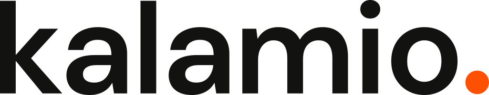

# Kalamio brand kit

The Kalamio logo, icons and link previews. SVGs are the masters; every PNG is rendered from them at the size listed.

<picture>
  <source media="(prefers-color-scheme: dark)" srcset="logo/kalamio-logo-on-dark.svg">
  
</picture>

## The idea

The logo is our name with a full stop: **kalamio.** The orange full stop is the ink dot, the drop of ink that ends a sentence. "Write to the world." ends the same way.

The mark **k.** is the first letter and the same dot. Use it in small, square spaces: the app icon, the favicon, avatars and the editor bar.

## Colours

| Name | Hex | Use |
| --- | --- | --- |
| Kalamio Orange | `#FD5002` | The ink dot, primary actions, accents |
| Ink | `#121211` | Letters on light backgrounds, the app icon background |
| Paper | `#FCFCFA` | Light backgrounds, letters on dark or orange |
| Charcoal | `#1F1F1E` | Dark backgrounds |

These match the app's theme tokens: `--c-kalamio`, and the light and dark values of `--c-black` / `--c-white` in `frontend/src/index.css`.

## Type

The letters are DM Sans SemiBold (weight 600) at optical size 32, set lowercase with default spacing and converted to outlines. The ink dot is a perfect circle, 1.2 times the size of DM Sans's own full stop, in the same place.

The favicon uses a heavier cut (DM Sans ExtraBold, optical size 14), fitted to the 16 px pixel grid so it stays sharp in a browser tab. The app's UI font is also DM Sans.

## Files

### `logo/`

| File | Use | PNG size |
| --- | --- | --- |
| `kalamio-logo` | Ink letters, orange dot. Light backgrounds | 4096 × 799 |
| `kalamio-logo-on-dark` | Paper letters, orange dot. Dark backgrounds | 4096 × 799 |
| `kalamio-logo-white` | All paper. Orange backgrounds and photos | 4096 × 799 |
| `kalamio-logo-ink` | All ink. One-colour print | 4096 × 799 |
| `kalamio-mark` | The k. mark: ink k, orange dot. Light backgrounds | 2048 × 2048 |
| `kalamio-mark-on-dark` | Paper k, orange dot. Dark backgrounds | 2048 × 2048 |
| `kalamio-mark-white`, `kalamio-mark-ink` | One-colour mark in paper or ink | 2048 × 2048 |
| `kalamio-logo-panel-{orange,light,dark}.png` | Logo centred on a brand background, for slides and press | 3840 × 2160 |

### `icon/`

| File | Use | Size |
| --- | --- | --- |
| `app-icon` | Ink rounded square, paper k, orange dot. The main icon | 1024 |
| `app-icon-light` | Paper rounded square, ink k, orange dot | 1024 |
| `app-icon-square.png` | Full-bleed square, for stores that apply their own mask | 1024 |
| `profile-picture` | Ink circle, for social and GitHub avatars | 1024 |
| `profile-picture-square.png` | Square version, for networks that crop to a circle themselves | 1024 |
| `favicon.svg`, `favicon.ico` | Browser tab icon. The `.ico` holds 16, 32 and 48 px | — |
| `favicon-{16,32,48,64}.png` | Single-size favicons | as named |
| `apple-touch-icon.png` | iOS home screen | 180 |
| `icon-192.png`, `icon-512.png` | Web app manifest icons | as named |

### `social/`

| File | Use | Size |
| --- | --- | --- |
| `og-image` | Link preview (Open Graph / Twitter card) | 1200 × 630, `@2x` 2400 × 1260 |
| `github-social-preview.png` | Social preview for the GitHub repository (Settings → Social preview) | 1280 × 640 |

### Email images

The emails the server sends (`server/services/email.service.js`) use small PNGs from `frontend/public/email/`, which the site serves at `https://kalamio.com/email/`. Render them again when the logo changes.

| File | Rendered from | Size | Shown at |
| --- | --- | --- | --- |
| `kalamio-logo-on-dark.png` | `logo/kalamio-logo-on-dark.svg` on an Ink background, matching the email's header band | 256 × 50 | 128 × 25 |
| `app-icon.png` | `icon/app-icon.svg` | 96 × 96 | 32 × 32 |

## Using the logo

- **The dot is orange.** The full stop is always Kalamio Orange, in light and dark mode. The letters are ink on light backgrounds and paper on dark ones.
- **On orange:** use the all-paper version (`kalamio-logo-white`, `kalamio-mark-white`), because an orange dot would disappear.
- **Wordmark first:** use `kalamio.` wherever there is room. Use the `k.` mark only in small or square spaces.
- **One colour:** the all-ink and all-paper versions are for print and single-colour use.
- **Clear space:** keep space equal to the height of the letter "a" free on every side.
- **Minimum size:** 72 px wide for the wordmark, 16 px for the mark.
- **Containers:** inside the app icon the k is 52% of the icon's height; inside a round avatar it is 50%.
- Don't recolour or move the dot, swap it for another shape, or add a second orange dot. Don't stretch, outline or add effects to the logo, and don't retype the wordmark in a live font.
- On busy photos, use `kalamio-logo-white` over a darkened area, or the app icon.

In the web app the logo is the `<Logo />` component (`frontend/src/components/Logo.jsx`), an inline SVG built from these same outlines. Its letters follow the current text colour, so one component covers both themes; the dot always stays orange.
