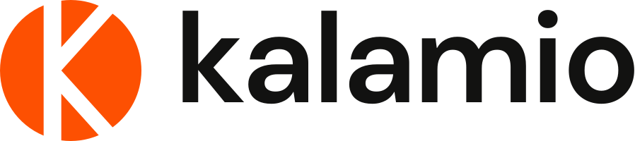

# Kalamio brand kit

The Kalamio logo, icons and link preview. SVGs are the masters; every PNG is rendered from them at the size listed.

<picture>
  <source media="(prefers-color-scheme: dark)" srcset="logo/kalamio-logo-on-dark.svg">
  
</picture>

## Colours

| Name | Hex | Use |
| --- | --- | --- |
| Kalamio Orange | `#FD5002` | The mark, primary actions, accents |
| Ink | `#121211` | Wordmark and text on light backgrounds |
| Paper | `#FCFCFA` | Light backgrounds, wordmark on dark or orange |
| Charcoal | `#1F1F1E` | Dark backgrounds |

These match the app's theme tokens: `--c-kalamio`, and the light and dark values of `--c-black` / `--c-white` in `frontend/src/index.css`.

## Type

The wordmark is DM Sans SemiBold at its display optical size, set lowercase with default spacing and converted to outlines. The app's UI font is also DM Sans.

## Files

### `logo/`

| File | Use | PNG size |
| --- | --- | --- |
| `kalamio-logo` | Orange mark, ink wordmark. Light backgrounds | 4096 × 912 |
| `kalamio-logo-on-dark` | Orange mark, paper wordmark. Dark backgrounds | 4096 × 912 |
| `kalamio-logo-white` | All paper. Orange backgrounds and photos | 4096 × 912 |
| `kalamio-logo-ink` | All ink. One-colour print | 4096 × 912 |
| `kalamio-mark` | The K-mark alone, orange | 2048 × 2048 |
| `kalamio-mark-white`, `kalamio-mark-ink` | The mark in paper or ink | 2048 × 2048 |
| `kalamio-logo-panel-{orange,light,dark}.png` | Lockup centred on a brand background, for slides and press | 3840 × 2160 |

### `icon/`

| File | Use | Size |
| --- | --- | --- |
| `app-icon` | Orange rounded square, paper mark | 1024 |
| `app-icon-dark` | Charcoal rounded square, orange mark | 1024 |
| `app-icon-square.png` | Full-bleed square, for stores that apply their own mask | 1024 |
| `profile-picture` | Orange circle, for social and GitHub avatars | 1024 |
| `profile-picture-square.png` | Square version, for networks that crop to a circle themselves | 1024 |
| `favicon.svg`, `favicon.ico` | Browser tab icon. The `.ico` holds 16, 32 and 48 px | — |
| `favicon-{16,32,48,64}.png` | Single-size favicons | as named |
| `apple-touch-icon.png` | iOS home screen | 180 |
| `icon-192.png`, `icon-512.png` | Web app manifest icons | as named |

### `social/`

| File | Use | Size |
| --- | --- | --- |
| `og-image` | Link preview (Open Graph / Twitter card) | 1200 × 630, `@2x` 2400 × 1260 |

## Using the logo

- **Clear space:** keep at least half the mark's height free on every side.
- **Minimum size:** 16 px for the mark, 80 px wide for the full logo.
- **Containers:** inside an app icon or avatar, the mark is 62% of the container's width.
- Don't recolour, rotate, stretch, outline or add effects to the logo, and don't retype the wordmark in a live font.
- On busy photos, use `kalamio-logo-white` over a darkened area, or the app icon.

In the web app the logo is the `<Logo />` component (`frontend/src/components/Logo.jsx`), an inline SVG built from these same paths. Its wordmark follows the current text colour, so one component covers both themes.
